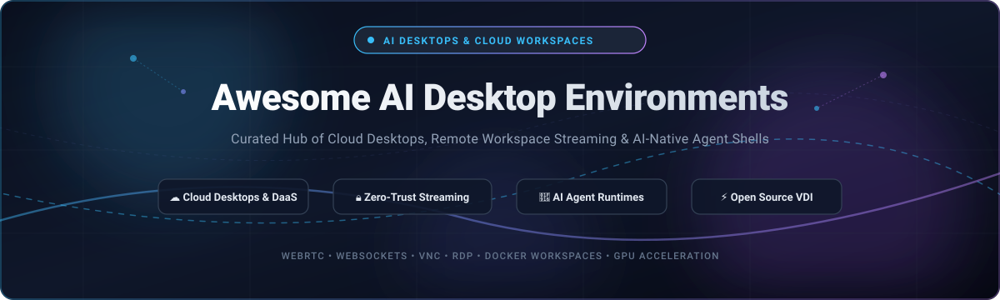

<p align="center">
  
</p>

# 🖥️ Awesome AI Desktop Environments

<p align="center">
  <a href="https://github.com/ishandutta2007/Awesome-Awesome-Awesome"></a>
  <a href="https://discord.gg/jc4xtF58Ve"></a>
  <a href="https://github.com/ishandutta2007/Awesome-AI-Desktop-Environments/stargazers"></a>
  <a href="https://github.com/ishandutta2007/Awesome-AI-Desktop-Environments/network/members"></a>
  <a href="https://github.com/ishandutta2007/Awesome-AI-Desktop-Environments/blob/main/LICENSE"></a>
  <a href="https://github.com/ishandutta2007"></a>
</p>

---

## 🌟 Overview & Ecosystem Architecture

Welcome to the definitive, community-driven catalog of **AI Desktop Environments**, **Cloud Desktops (DaaS)**, **Virtual Desktop Infrastructure (VDI)**, and **Containerized Workspace Streaming**. 

As autonomous AI agents, developer workspaces, and remote enterprise operations converge, graphical desktop environments serve as the critical interactive layer. This ecosystem powers:
- 🤖 **AI Agent Harnesses & Native Shells**: Wrapping multi-agent runtimes, tool-calling systems, and browser-use agents into native desktop windows with lifecycle orchestration.
- ☁️ **Cloud Desktops & DaaS**: Delivering full Windows, macOS, and Linux virtual environments over WebRTC and WebSockets with zero endpoint footprint.
- 🔒 **Zero-Trust Ephemeral Sandboxing**: Streaming isolated containerized browsers and desktop sessions for safe code execution, testing, and browsing.
- ⚡ **High-FPS Remote Streaming**: Ultra-low-latency NVENC/VAAPI-accelerated GPU desktop remoting for gaming, 3D workstations, and machine learning.

---

## 📑 Table of Contents

- [📊 Sector Overview & Market Dynamics](#-sector-overview--market-dynamics)
- [🏢 SaaS / Hosted Cloud Platforms](#-saas--hosted-cloud-platforms)
- [💻 Open-Source GitHub Projects](#-open-source-github-projects)
- [🛠️ Architecture Blueprint for Custom Systems](#-architecture-blueprint-for-custom-systems)
- [🤝 How to Contribute](#-how-to-contribute)
- [💖 Support & Sponsorship](#-support--sponsorship)
- [📈 Star History](#-star-history)
- [⚖️ Disclaimer & Compliance](#-disclaimer--compliance)

---

## 📊 Sector Overview & Market Dynamics

The global Desktop-as-a-Service (DaaS) and cloud virtual desktop market is estimated at **$6B–$9.5B in 2024–2025** and projected to reach **$22B–$50B by the mid-2030s** (expanding at a **13%–18.5% CAGR**). 

- **Market Structure & Fragmentation**: The broader ecosystem is **moderately fragmented** across regional Managed Service Providers (MSPs), container-streaming startups, and browser-isolation innovators.
- **Enterprise Concentration**: High-end enterprise desktop infrastructure is **highly concentrated** among an entrenched oligopoly of hyperscalers and virtualization incumbents (Microsoft, AWS, Citrix, and VMware/Omnissa).
- **Emerging Frontier**: The intersection of **autonomous AI agents and graphical user interfaces (GUI-agents)** is driving a major resurgence in demand for fast, containerized, headless desktop harnesses capable of programmatic interaction and real-time visual streaming.

---

## 🏢 SaaS / Hosted Cloud Platforms

The table below lists leading commercial Desktop-as-a-Service (DaaS) and hosted cloud computer providers, **sorted descending by company size / valuation / market capitalization**.

| Platform | Company Size (Valuation / Revenue) | Starting Pricing | Free Tier / Trial Limits | Core Capabilities |
| :--- | :--- | :--- | :--- | :--- |
| **[Windows 365](https://www.microsoft.com/en-us/windows-365)** | ~$3.1T Market Cap / ~$245B Annual Rev (Microsoft) | From $28.00/user/mo (Enterprise) or $36.00/user/mo (Business, 2 vCPU / 8GB RAM / 128GB SSD) | 30-day free trial; 1 Cloud PC per tenant (2 vCPU, 8 GB RAM, 128 GB storage) | Microsoft's enterprise Cloud PC delivering full Windows 11 streaming to any browser or thin client with Intune and Entra ID governance. |
| **[Azure Virtual Desktop](https://azure.microsoft.com/en-us/products/virtual-desktop/)** | ~$3.1T Market Cap / ~$245B Annual Rev (Microsoft) | From $5.50–$10.00/user/mo external access + Azure VM consumption (pooled multi-session starts from ~$10/user/mo) | 30-day trial with $200 Azure credits; includes 12 months of select free services (session host compute deducts from credits) | Enterprise cloud VDI with multi-session Windows 10/11, FSLogix profile containers, MSIX app attach, and deep Azure integration. |
| **[Amazon WorkSpaces](https://aws.amazon.com/workspaces/)** | ~$2.0T Market Cap / ~$105B AWS Run-rate (Amazon) | From $7.25/mo + $0.22/hr (hourly metered) or flat $21.00/user/mo (Value tier: 1 vCPU / 2GB RAM / 80GB root) | 3-month free trial; up to 2 Standard AutoStop WorkSpaces with 40 combined monthly hours, 80GB root + 50GB user volumes | Fully managed desktop virtualization on AWS with Windows, Amazon Linux, and Ubuntu desktop streaming plus WorkSpaces Web. |
| **[Citrix Workspace](https://www.citrix.com/)** | $16.5B Take-Private Acquisition (Cloud Software Group) | From $10.00/user/mo (Citrix DaaS Standard; minimum user seats and infrastructure compute apply) | 7-day guided trial via Azure Marketplace, or 30-day custom enterprise Proof-of-Concept (PoC) | Enterprise digital workspace delivering virtual apps and desktops with proprietary HDX protocol and zero-trust perimeter control. |
| **[VMware Horizon](https://www.vmware.com/products/horizon.html)** | $4.0B Acquisition by KKR (Omnissa / ex-VMware EUC) | From $9.00–$12.50/user/mo (Horizon Cloud control plane license; underlying cloud VM compute billed separately) | 30-day to 60-day free trial for Horizon Cloud Service (accessible via Azure/AWS marketplace evaluation) | Virtual desktop and application delivery platform featuring Blast Extreme protocol, App Volumes, and Dynamic Environment Manager. |
| **[Paperspace](https://www.paperspace.com/)** | $111M Acquisition by DigitalOcean (~$3.5B Market Cap) | From $0.07/hr or $8.00/mo (CPU/GPU Core virtual desktops) + $5.00/mo persistent storage | Free tier for Gradient Notebooks (5 GB persistent storage, 1 concurrent instance, 6-hr session timeout; no free Core VDI) | High-performance GPU & CPU cloud workstations and ML dev environments with WebRTC browser streaming and low-latency client. |
| **[Shadow PC](https://shadow.tech/)** | ~$30M–$50M Est. Valuation (€2M debt-clearing buyout + backing by Octave Klaba / Synfonium) | From $29.99/mo (Neo Lite: 16GB RAM, RTX 2000 Ada tier, 120 hrs/mo cap) | No free trial or free tier; introductory promotional discounts offered periodically (no partial refunds) | High-performance cloud PC streaming dedicated NVIDIA RTX gaming and workstation GPUs at up to 4K/5K 240Hz for creative and gaming workloads. |
| **[Neverinstall](https://neverinstall.com/)** | ~$5M–$15M Est. Seed Valuation (~$1.5M Venture Funding Raised) | From $15.00/mo (Basic plan) or $50.00/mo (Premium plan) | Free forever plan with 1-hour session limit per launch (basic compute, resets between sessions) | Cloud application and desktop streaming platform that executes Linux and Windows apps in the cloud and streams them via web browser. |
| **[Kasm Cloud](https://kasm.com/)** | ~$2.8M Annual Recurring Revenue (Kasm Technologies, private) | From $5.00/user/mo (Personal Cloud) or $19.00/user/yr (Enterprise license self-hosted) | Free Community Edition (self-hosted: 5 concurrent sessions forever, community support); Cloud Personal free slots vary | Managed containerized desktop streaming, browser isolation, and web-native app delivery with SOC 2 Type II attestation. |
| **[Shells](https://shells.com/)** | Privately Held / Seed stage (E Shells, Inc.) | From $4.95/mo (Lite: 1 vCPU, 2GB RAM, 40GB storage, 10 hrs/mo) or $11.95/mo (Basic unlimited) | No free tier; 7-day money-back guarantee on all plans to test risk-free | Personal and small-business cloud computer streaming accessible from any web browser, smart TV, or mobile device. |

---

## 💻 Open-Source GitHub Projects

The following open-source projects provide the infrastructure, streaming protocols, display servers, and AI desktop shells for building self-hosted, sovereign, and privacy-preserving desktop environments. 

**Sorted descending by GitHub Star Count ⭐:**

### 1. [RustDesk](https://github.com/rustdesk/rustdesk) [](https://github.com/rustdesk/rustdesk/stargazers)
> **License**: AGPL-3.0 | **Primary Tech**: Rust, Flutter
The premier open-source remote desktop client and server software written in Rust. Works out of the box with zero configuration and serves as a sovereign, self-hostable alternative to TeamViewer, AnyDesk, and LogMeIn. Supports end-to-end encryption, multi-platform clients (Windows, macOS, Linux, Android, iOS), and full display control.

### 2. [Sunshine](https://github.com/LizardByte/Sunshine) [](https://github.com/LizardByte/Sunshine/stargazers)
> **License**: GPL-3.0 | **Primary Tech**: C++, WebRTC, NVENC/VAAPI
A self-hosted game stream and remote desktop host for Moonlight. Provides low-latency, 60–120+ FPS desktop and application streaming using hardware-accelerated video encoding (NVENC, AMD AMF, Intel QuickSync, and VAAPI). Features a responsive Web UI for configuration and gamepad/mouse/keyboard pass-through.

### 3. [DSH Desktop (anywhere-labs)](https://github.com/anywhere-labs/dsh-desktop) [](https://github.com/anywhere-labs/dsh-desktop/stargazers)
> **License**: Open Source | **Primary Tech**: Electron, TypeScript, Node.js
The reference open-source AI-native desktop environment for DeepSeek Harness (DSH). Wraps multi-agent CLI harnesses into a native desktop shell with system tray lifecycle management, single-instance process locking, local service orchestration, and native OS windowing without forking upstream agent semantics.

### 4. [Neko](https://github.com/m1k1o/neko) [](https://github.com/m1k1o/neko/stargazers)
> **License**: Apache-2.0 | **Primary Tech**: Go, WebRTC, Vue.js
A self-hosted virtual browser and remote desktop streaming system that runs inside Docker and streams graphical Linux environments via WebRTC. Features synchronized multi-user collaborative browsing, shared cursor/keyboard control, broadcast audio/video, and RTMP external streaming.

### 5. [Moonlight Qt](https://github.com/moonlight-stream/moonlight-qt) [](https://github.com/moonlight-stream/moonlight-qt/stargazers)
> **License**: GPL-3.0 | **Primary Tech**: C++, Qt
GameStream and desktop client for Sunshine and NVIDIA GameStream. Streams full desktop environments and graphics-intensive workflows from PC to any device at up to 4K 120 FPS with ultra-low latency, HDR support, and surround sound passthrough.

### 6. [dataelement / dsh-desktop](https://github.com/dataelement/dsh-desktop) [](https://github.com/dataelement/dsh-desktop/stargazers)
> **License**: Open Source | **Primary Tech**: Electron, Python, Node.js
Local-first, cross-platform AI desktop application for DeepSeek Harness. Features automated PPT generation with 16 templates and editable output, local network smartphone pairing, portable agent presets (`.dshpreset`), bundled Python skills for offline office document processing, and persistent profile upgrades.

### 7. [noVNC](https://github.com/novnc/noVNC) [](https://github.com/novnc/noVNC/stargazers)
> **License**: MPL-2.0 | **Primary Tech**: JavaScript, HTML5 WebSockets
The foundational HTML5 VNC client library and application. Implements an RFB-compatible client entirely in browser JavaScript using HTML5 Canvas and WebSockets. Powers browser-based remote consoles in OpenStack, Proxmox VE, Kubernetes, and Kasm.

### 8. [FreeRDP](https://github.com/FreeRDP/FreeRDP) [](https://github.com/FreeRDP/FreeRDP/stargazers)
> **License**: Apache-2.0 | **Primary Tech**: C
A free, open-source implementation of the Remote Desktop Protocol (RDP), released under the Apache license. Serves as the core client and server library powering enterprise RDP clients across Linux, macOS, Android, and embedded thin clients worldwide.

### 9. [MeshCentral](https://github.com/Ylianst/MeshCentral) [](https://github.com/Ylianst/MeshCentral/stargazers)
> **License**: Apache-2.0 | **Primary Tech**: Node.js, JavaScript
A complete web-based remote computer management and remote desktop web application. Enables full remote desktop control, terminal shell access, and file transfers over the web through local networks or reverse proxies without port forwarding.

### 10. [xrdp](https://github.com/neutrinolabs/xrdp) [](https://github.com/neutrinolabs/xrdp/stargazers)
> **License**: Apache-2.0 | **Primary Tech**: C
An open-source Remote Desktop Protocol (RDP) server allowing Linux servers to accept incoming RDP connections from native Windows Remote Desktop Connection clients. Supports two-way clipboard, audio redirection, and drive redirection.

### 11. [x11docker](https://github.com/mviereck/x11docker) [](https://github.com/mviereck/x11docker/stargazers)
> **License**: MIT | **Primary Tech**: Bash, X11, Wayland
Run graphical desktop environments and GUI applications safely inside Docker and Podman containers. Bridges desktop display servers (Xorg, Xephyr, Xwayland) with container sandboxing, GPU acceleration, audio forwarding, and clipboard sharing.

### 12. [KasmVNC](https://github.com/kasmtech/KasmVNC) [](https://github.com/kasmtech/KasmVNC/stargazers)
> **License**: GPL-2.0 | **Primary Tech**: C, C++, JavaScript
A modern, web-native VNC server and client engineered for streaming containerized desktop sessions directly to modern web browsers over WebSockets with built-in HTTP/HTTPS serving, YAML-based configuration, and WebP/JPEG video compression.

### 13. [linuxserver / docker-webtop](https://github.com/linuxserver/docker-webtop) [](https://github.com/linuxserver/docker-webtop/stargazers)
> **License**: GPL-3.0 | **Primary Tech**: Dockerfile, Shell
Containerized Linux desktop environments (Alpine, Ubuntu, Arch, Fedora) streamed directly to web browsers via HTTP/HTTPS. Built with modern desktop managers (XFCE, KDE, MATE, i3, Openbox) and hardware acceleration support.

### 14. [Selkies](https://github.com/selkies-project/selkies) [](https://github.com/selkies-project/selkies/stargazers)
> **License**: MPL-2.0 | **Primary Tech**: Rust, Python, WebSockets/WebRTC
Low-latency, hardware-accelerated remote desktop streaming platform designed for containers, Kubernetes, HPC, and cloud gaming. Features a Rust-based capture engine (`pixelflux`), zero-copy GPU pipeline, 60+ FPS Full HD streaming, two-way clipboard, and gamepad/webcam passthrough.

### 15. [wolf (games-on-whales)](https://github.com/games-on-whales/wolf) [](https://github.com/games-on-whales/wolf/stargazers)
> **License**: GPL-3.0 | **Primary Tech**: C++, Docker, WebRTC
An open-source stream server for running games and virtual desktop environments in Docker containers and streaming them with low latency to Moonlight clients.

### 16. [Apache Guacamole](https://github.com/apache/guacamole-server) [](https://github.com/apache/guacamole-server/stargazers)
> **License**: Apache-2.0 | **Primary Tech**: C, Java, HTML5
Clientless remote desktop gateway supporting standard protocols like VNC, RDP, and SSH. End users access full remote desktops through an HTML5 web browser without installing local plugins or agent software.

### 17. [gow (games-on-whales)](https://github.com/games-on-whales/gow) [](https://github.com/games-on-whales/gow/stargazers)
> **License**: Apache-2.0 | **Primary Tech**: Docker, Shell
Containerized gaming and desktop applications (Steam, Firefox, RetroArch) packaged into standalone Docker images with NVIDIA/AMD GPU passthrough and audio forwarding.

### 18. [workspaces-core-images (Kasm)](https://github.com/kasmtech/workspaces-core-images) [](https://github.com/kasmtech/workspaces-core-images/stargazers)
> **License**: Open Source | **Primary Tech**: Dockerfile, Shell
The official Docker images powering Kasm Workspaces containerized desktop and browser delivery, including Ubuntu, Debian, CentOS, AlmaLinux, Kali Linux, and specialized development environments.

### 19. [IsardVDI](https://gitlab.com/isard/isardvdi)
> **License**: AGPL-3.0 | **Primary Tech**: Python, Docker, QEMU/KVM
Comprehensive open-source virtual desktop infrastructure (VDI) management platform. Orchestrates multi-hypervisor KVM virtual machines with NVIDIA Grid vGPU support, web viewer streaming (SPICE, noVNC, Guacamole RDP), and browser-based administration.

### 20. [OpenThinRdp](https://github.com/OpenThinRdp/openthinrdp) [](https://github.com/OpenThinRdp/openthinrdp/stargazers)
> **License**: Open Source | **Primary Tech**: C, Shell
Specialized thin-client Linux operating system with RDP over UDP support. Designed as an open-source alternative to IGEL and Dell ThinOS for streaming remote Windows VDI sessions with USB token redirection.

### 21. [dsh_desktop (Tauri)](https://dshbase.com/plugins/dsh_desktop/)
> **License**: Open Source | **Primary Tech**: Rust, Tauri 2
A modern AI desktop shell architecture written with Tauri 2 and Rust, offering minimal RAM footprint, rapid startup, and a guardian process for self-healing AI agent services.

### 22. [zcy0735111-png / dsh-desktop](https://github.com/zcy0735111-png/dsh-desktop) [](https://github.com/zcy0735111-png/dsh-desktop/stargazers)
> **License**: Open Source | **Primary Tech**: Node.js, Batch
Zero-dependency Windows portable client for DeepSeek Harness that bundles Node.js, auto-discovers active port bindings, and manages background CLI process lifetimes.

---

## 🛠️ Architecture Blueprint for Custom Systems

Building your own sovereign, enterprise-grade AI desktop or cloud streaming environment? Here is the recommended architectural composition:

```
┌────────────────────────────────────────────────────────┐
│                   User Web Browser                     │
│          (WebRTC / WebSockets / HTML5 Canvas)          │
└───────────────────────────▲────────────────────────────┘
                            │
┌───────────────────────────┴────────────────────────────┐
│         Gateway / Ingress / Authentication             │
│   (Apache Guacamole / MeshCentral / NGINX / Traefik)   │
└───────────────────────────▲────────────────────────────┘
                            │
┌───────────────────────────┴────────────────────────────┐
│            Display Streaming & Remoting Layer          │
│       (Selkies WebRTC / KasmVNC / Sunshine / xrdp)     │
└───────────────────────────▲────────────────────────────┘
                            │
┌───────────────────────────┴────────────────────────────┐
│             Desktop Environment Runtime                │
│    (XFCE / KDE / Docker-Webtop / x11docker / QEMU)     │
└───────────────────────────▲────────────────────────────┘
                            │
┌───────────────────────────┴────────────────────────────┐
│            AI Agent Harness & Native Shell             │
│    (DSH Desktop / Claude Computer Use / Browser-Use)   │
└────────────────────────────────────────────────────────┘
```

1. **Protocol Gateway**: Deploy **Apache Guacamole** or **MeshCentral** for central access control, user authentication, and clientless HTML5 gateway routing.
2. **Streaming Engine**: Utilize **Selkies** (WebSockets/WebRTC) or **Sunshine** for high-frame-rate, hardware-accelerated GPU remoting, or **KasmVNC** for lightweight browser VNC streaming.
3. **Workspace Isolation**: Run desktop environments in containerized sandboxes using **docker-webtop** or **x11docker** to ensure zero residual endpoint state.
4. **AI Agent Shell**: Interface agent runtimes using **DSH Desktop** or programmatic virtual framebuffers for automated GUI navigation and autonomous workflows.

---

## 🤝 How to Contribute

Contributions are welcome! To contribute to this curated ecosystem:

1. 🍴 **Fork the repository** on GitHub.
2. 🌿 **Create a new branch**: `git checkout -b feature/add-new-desktop-tool`.
3. 📝 **Add your entry** under the appropriate SaaS or Open-Source section following the existing formatting and schema (name, repo link, star badge, license, and factual description).
4. ✅ **Ensure accuracy**: Verify pricing, license types, and GitHub repository links.
5. 🚀 **Submit a Pull Request** with a concise description of why the tool is notable for AI desktop environments.

---

## 💖 Support & Sponsorship

If you find this repository valuable for your research, infrastructure, or AI development workflows, please consider supporting the project:

- ⭐ **Star this repository** to help others discover it!
- 🍴 **Fork and share** with colleagues and developer communities.
- ☕ **Sponsor or Buy a Coffee**: Support ongoing maintenance and open-source curation via the [GitHub Sponsors Dashboard](https://github.com/sponsors/ishandutta2007).

Your support keeps this directory independent, accurate, and continuously updated. Thank you!

---

## 📈 Star History

[](https://star-history.dera.page/#ishandutta2007/Awesome-AI-Desktop-Environments&type=date&legend=top-left)

---

## ⚖️ Disclaimer & Compliance

- This repository is an independent, **community-curated index** and is not affiliated with or endorsed by Microsoft, Amazon, Citrix, VMware, or any listed entity.
- AI desktop environments and remote streaming platforms handling enterprise data, credentials, and user sessions must comply with data governance regulations (GDPR, CCPA, HIPAA) and zero-trust security frameworks.
- Benchmarks, pricing, and free tier quotas are subject to change by respective vendors and maintainers. Always verify terms on the official provider portals.

---

<p align="center">
  <b>Built for platform engineers, remote work architects, and AI developers building the future of desktop environments.</b>
</p>
